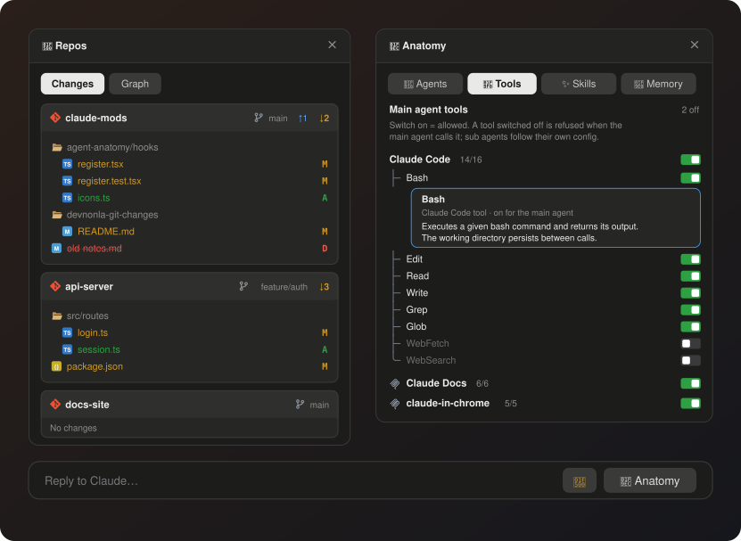
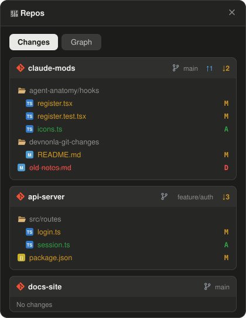
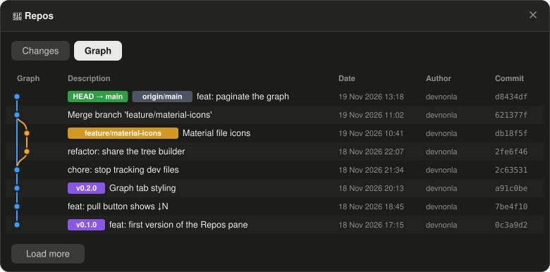
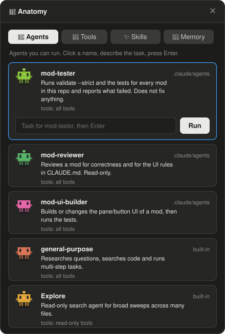
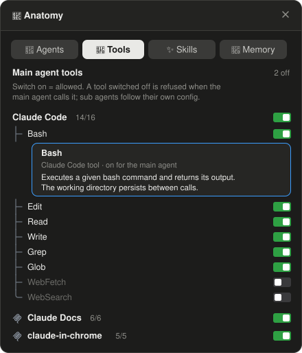
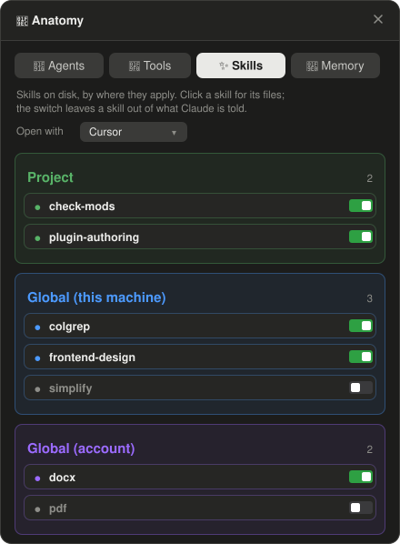
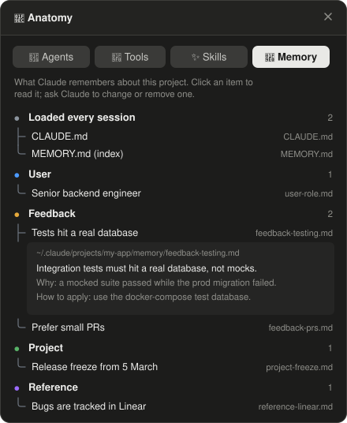

# claude-mods

Mods for [Claude Code](https://claude.com/claude-code) by devnonla. A mod adds a button, a side pane or a command to Claude's own interface, and it hot-reloads: nothing to build, nothing to configure.

<p align="center">
  
</p>

> The pictures in this repo are illustrations drawn from each mod's layout and colors, not screenshots. Real rendering follows your Claude theme.

## The mods

### 🔀 devnonla-git-changes

See every git repo in your working folder at a glance: which ones have uncommitted changes, what changed, and how the history looks. Click a file to open its diff, click `↓N` to pull.

<p>
  
  
</p>

Opens from the 🔀 button beside the input box (yellow when something is dirty, green when all is clean) or with `/repos`. [Read more](devnonla-git-changes)

### 🧬 agent-anatomy

Dissect the main agent: the agents it can run, the tools it can call (with on/off switches), the skills it can use and what it remembers about your project.

<p>
  
  
  
  
</p>

Opens from the 🧬 Anatomy button beside the input box or with `/anatomy`. [Read more](agent-anatomy)

| Mod | What it adds | Command |
| --- | --- | --- |
| [devnonla-git-changes](devnonla-git-changes) | Repos pane: changed-file tree per repo, diff on click, pull, commit graph | `/repos` |
| [agent-anatomy](agent-anatomy) | Anatomy pane: agents, tools (switchable), skills (switchable) and project memory | `/anatomy` |

## Install

Add the marketplace once (nothing is installed yet):

```bash
claude plugin marketplace add devnonla/claude-mods
```

Then install the mods you want:

```bash
claude plugin install devnonla-git-changes@devnonla-mods
```

```bash
claude plugin install agent-anatomy@devnonla-mods
```

In Claude desktop: click `+` next to the input box, choose **Plugins**, **Add marketplace** with `devnonla/claude-mods`, then **Add plugin**.

To update a mod:

```bash
claude plugin update devnonla-git-changes
```

## Try a mod from a local folder

```bash
git clone https://github.com/devnonla/claude-mods
claude --plugin-dir claude-mods/agent-anatomy
```

Edits to the folder reload live.

## Credits

File-type icons are from [Material Icon Theme](https://github.com/material-extensions/vscode-material-icon-theme) (MIT, see the `NOTICE-material-icon-theme.txt` inside each mod).
