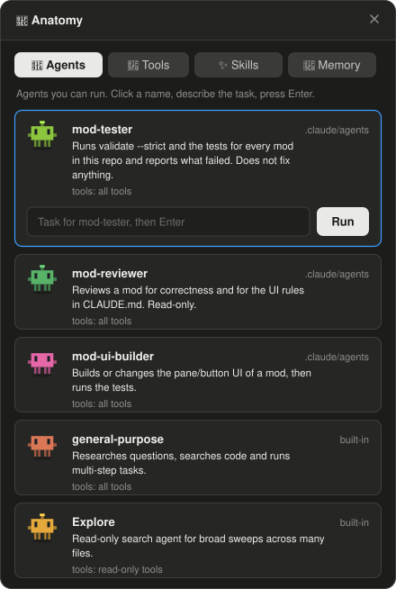
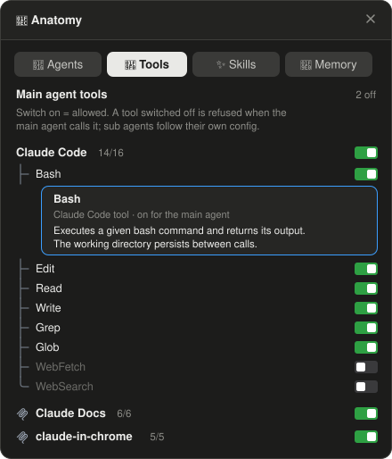
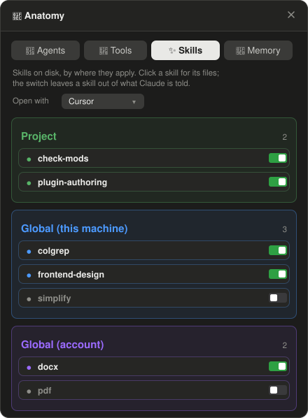
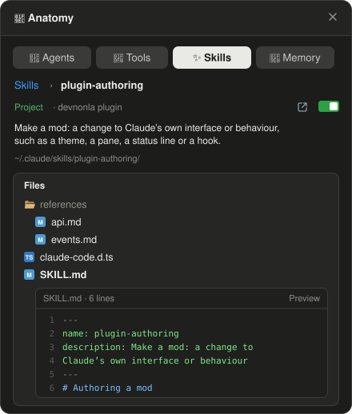
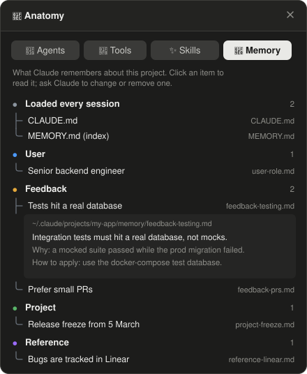

# agent-anatomy

A Claude Code mod that dissects the main agent, so you can see what it is able to do in this project: the agents it can run, the tools it has, the skills it can use and what it remembers.

## Open it

- Click the **🧬 Anatomy** button at the foot of the input box (`◈ Anatomy` in the terminal). Click again to close.
- Or run the `/anatomy` command.

The pane has four tabs: **Agents**, **Tools**, **Skills** and **Memory**.

## 🤖 Agents



The agents you can run, each with its own pixel avatar:

- the project's own agents (`.claude/agents/*.md`: name, description, tools);
- the built-in ones (general-purpose, Explore, Plan).

Click a name, describe the task, press Enter to run it.

<br clear="right">

## 🧰 Tools



The main agent's tools as a tree, one tool per line, in groups: **Claude Code** (built-in tools) and one group per MCP server, each with its icon, `on/total` and a switch for the whole group. Click a group name to fold or unfold it (MCP groups start folded). Click a tool's name for its detail: name, where it comes from, full description and state.

- **Switch off = refused.** A tool switched off is refused when the **main agent** calls it. Sub agents are not affected and follow their own config.
- The tool stays in the model's tool list, so the model may still try it once and be told no.
- Switches persist across sessions of the **same project** (stored per project root).
- A server whose key is an opaque id can be named in `SERVER_NAMES` at the top of `hooks/register.tsx`.

<br clear="right">

## ✨ Skills



The skills found on disk, grouped by where they apply, each group a block tinted with its color:

| Group | Where from |
| --- | --- |
| **Project** | `.claude/skills`, and plugins installed for this project |
| **Global (this machine)** | `~/.claude/skills`, and plugins installed for the user |
| **Global (account)** | skills synced from your claude.ai account |

A plugin installed for another project is left out. Skills the app builds in hold no file, so they are not listed.

Each skill is one line: a bullet in its group color, its name and a switch. A skill switched off is left out of the skill listing the model reads (so it costs no tokens and the model does not pick it), from the next turn. Typed as `/name` it still runs. Switches persist per project and match skills by name.

<br clear="right">

### Skill view



Click a skill's name to open its own view, with a breadcrumb (**Skills › name**) back to the list:

- its group and plugin, its switch, its description and folder;
- an arrow icon that opens its folder in an editor found on this machine (Cursor, VS Code, Windsurf, Zed, VSCodium, Sublime Text, IntelliJ IDEA or WebStorm: apps in `/Applications` on macOS, commands on the PATH elsewhere). With more than one, an **Open with** picker at the top of the list chooses, and it is kept across projects;
- its whole folder as a file tree, drawn like the Repos pane (Material Icon Theme icons, folders that fold; references, scripts, assets; folders first, `node_modules` and `.git` left out, at most 80 entries).

Click a file to read it in a viewer under it, with line numbers and syntax colors; a markdown file has **Preview** and **Source**. Nothing is copied. Trees are scanned once a session, so the tab opens at once.

<br clear="right">

## 🧠 Memory



What Claude remembers about this project (`~/.claude/projects/<project>/memory/*.md`), as a tree grouped by type:

- **Loaded every session**: the `CLAUDE.md` files (project and user) and the `MEMORY.md` index;
- **User**, **Feedback**, **Project**, **Reference** (and **Other**), each with a colored dot and a count.

Click a group name to fold it. Click an item to read its content right in the pane, taken from the original file (nothing is copied into the project); click it again to close.

It is read-only: ask Claude to change or remove an entry.

<br clear="right">

## Install

```bash
/plugin install agent-anatomy --marketplace devnonla/claude-mods
```

See the [repo README](../README.md) for the CLI and desktop install steps.

## Credits

File-type icons are from [Material Icon Theme](https://github.com/material-extensions/vscode-material-icon-theme) (MIT, Copyright (c) 2025 Material Extensions), as in devnonla-git-changes.

The MCP group icon is the Model Context Protocol mark from [modelcontextprotocol/modelcontextprotocol](https://github.com/modelcontextprotocol/modelcontextprotocol) (`docs/favicon.svg`).
