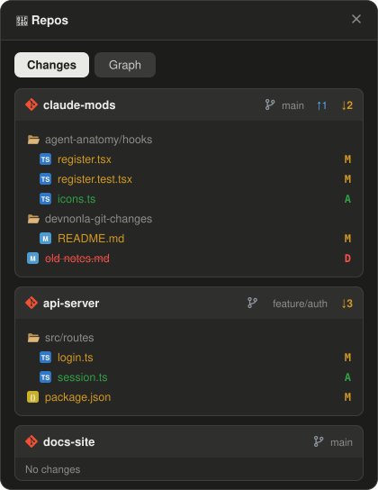
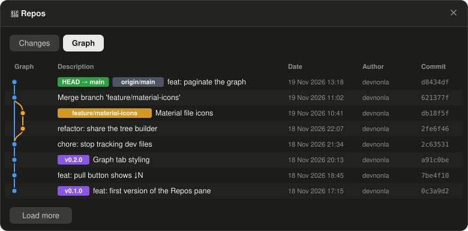

# devnonla-git-changes

A Claude Code mod that shows the git repos in your working folder (the root and its direct child repos): which ones have uncommitted changes, a changed-file tree like VS Code's Source Control, and a commit graph.

<p align="center">
  
</p>

## Open it

- Click the 🔀 button at the foot of the input box. It is yellow when any repo has changes and green when all are clean. Click again to close.
- Or run the `/repos` command.

The pane has two tabs: **Changes** and **Graph**.

## Changes tab

One card per repo: its name, its branch, and a tree of the changed files with a status letter on the right.

| Letter | Meaning |
| --- | --- |
| `M` | modified |
| `A` / `U` | added / untracked |
| `D` | deleted (struck through) |
| `R` | renamed |

| Click | Result |
| --- | --- |
| A file | Opens Claude desktop's built-in **Diff** pane for the session's own repo, or the **Files** pane for a child repo |
| A repo or folder name | Folds or unfolds it |
| `↓N` next to the branch | Runs `git pull --ff-only` (a fast-forward only, so it never makes a merge commit) |
| `↑N` | Shows how many commits you have not pushed |

Repos refresh every 5 seconds. A repo with no changes shows "No changes".

## Graph tab

<p align="center">
  
</p>

The commit history of one repo with the columns Graph, Description, Date, Author and Commit. Branch, remote and tag labels sit next to the subject.

- With one repo it is picked for you; with several, choose from the **Repo** dropdown.
- Loads the latest 100 commits of all branches, and **Load more** adds 100 more.
- While a repo's refs have not moved, it does not re-read the log.
- Narrow panes hide the Date and Author columns.
- The desktop app draws colored SVG lanes; the terminal draws them with box-drawing characters.

## Install

```bash
/plugin install devnonla-git-changes --marketplace devnonla/claude-mods
```

See the [repo README](../README.md) for the CLI and desktop install steps.

## Credits

File-type icons are from [Material Icon Theme](https://github.com/material-extensions/vscode-material-icon-theme) (MIT, see `NOTICE-material-icon-theme.txt`).
